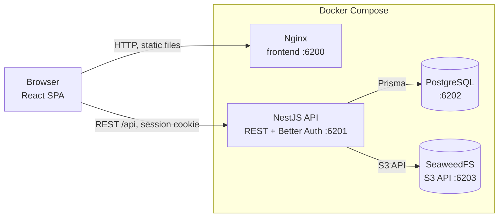

# HECHO

**HECHO** is a learning client-server order desk for a single organization: customers create orders, executors perform the work, and administrators manage users, order distribution, invoices, and payments.

[Documentation](./docs/README.md) · [English documentation](./docs/en/README.md) · [Русская документация](./docs/ru/README.md) · [Русский README](./README.md) · [Database schema](./docs/en/database-schema.md)

> [!IMPORTANT]
> **About the project and code quality**
>
> The project was built entirely in vibe-coding mode (AI-assisted development) and may contain inaccuracies, suboptimal decisions, and incomplete scenarios. The author is not a professional developer but a QA engineer. The project's main purpose is to be a lightweight, understandable base for showcasing the author as a QA engineer: test design, requirements analysis, API and UI testing, QA documentation, and automation skills. Do not treat this code as a production-ready reference.

## What it is

An application for accepting orders from registered customers, distributing and performing work, tracking time, and issuing internal invoices. It supports three roles:

- **Customer** — creates orders, approves estimates, accepts work, and submits payment proof.
- **Executor** — takes orders from the shared pool, proposes hours and cost, performs the work, and tracks time.
- **Administrator** — manages users, assigns and reassigns orders, issues invoices, verifies payments, and completes orders.

The interface is localized into English (default), Russian, and Spanish.

## Technologies

| Layer | Stack |
|---|---|
| Frontend | React 19, Vite 7, TypeScript, React Router, custom i18n (`en` / `ru` / `es`) |
| Backend | NestJS 12, REST API, Swagger/OpenAPI, class-validator, PDFKit |
| Authentication | Better Auth, server-side sessions in PostgreSQL, roles `CUSTOMER`, `EXECUTOR`, `ADMIN` |
| Database | PostgreSQL 17, Prisma 7, migrations and SQL constraints |
| Files | SeaweedFS 4.52 via an S3-compatible API, 1 MB limit per file |
| Infrastructure | Docker Compose, Nginx serving the frontend |
| Tests | API unit tests via `tsx --test`; e2e automation lives in a separate repository |

## Architecture

The project follows a client-server architecture. The browser loads the static React application from Nginx and calls the NestJS REST API; the API validates the session and permissions, works with PostgreSQL through Prisma, and stores files in SeaweedFS.



- Frontend — a single-page application with `/customer`, `/executor`, and `/admin` panels; Nginx supports direct URL navigation.
- API — domain logic, authentication, role and status-transition checks, file handling, and PDF invoice generation.
- PostgreSQL — users, categories, orders, history, estimates, invoices, and payments.
- SeaweedFS — order attachments and payment proof.
- Docker Compose starts all services, waits for PostgreSQL readiness, and applies migrations before the API starts.

## Quick start

### Requirements

- Docker Engine with Docker Compose v2 (`docker compose`); Docker Desktop works on Windows and macOS.
- Git.
- Free local ports `6200`–`6204`.
- Node.js `22.18+` and pnpm `12.15` are required only for host development; they are not needed for a Compose run.

### Run with Docker Compose

1. Clone the repository and go to its root.
2. Create a local environment file: `cp .env.example .env` (on Windows PowerShell: `Copy-Item .env.example .env`).
3. Replace every `replace-this-*` value in `.env` with unique local passwords and secrets. Set `ADMIN_EMAIL` and `ADMIN_PASSWORD` for the first administrator. The PostgreSQL password must be URL-safe (letters, digits, and `._~-`) because it is used in `DATABASE_URL`.
4. Build the images and start the services: `docker compose up --build -d`. The first run may take a few minutes; the API waits for PostgreSQL and applies migrations.
5. Create the initial administrator: `docker compose exec api pnpm --filter @order-desk/api db:seed:admin`. The command is safe to re-run.
6. Open `http://localhost:6200` and sign in with `ADMIN_EMAIL` / `ADMIN_PASSWORD`. The administrator creates executors; customers register independently.

The containers use `restart: "no"`, so they do not start automatically after a host reboot: bring the stack up manually with `docker compose up -d`.

| Service | Default address |
|---|---|
| Frontend | `http://localhost:6200` |
| API | `http://localhost:6201/api` |
| Swagger | `http://localhost:6201/api/docs` |
| Health check | `http://localhost:6201/api/health` |
| PostgreSQL | `localhost:6202` |
| SeaweedFS S3 API | `http://localhost:6203` |
| SeaweedFS Admin UI | `http://localhost:6204` |

All ports are bound to `127.0.0.1` and are available only from the local machine. For port configuration, hot-reload development, and the devtools API, see the [setup guide](./docs/en/README.md#running-the-project-locally).

## Documentation

| Section | English | Русский |
|---|---|---|
| Full documentation | [docs/en/README.md](./docs/en/README.md) | [docs/ru/README.md](./docs/ru/README.md) |
| Purpose and functionality | [Functionality](./docs/en/README.md#agreed-functionality) | [Функционал](./docs/ru/README.md#согласованный-функционал) |
| Technical constraints | [Constraints](./docs/en/README.md#technical-constraints-and-preferences) | [Ограничения](./docs/ru/README.md#технические-ограничения-и-пожелания) |
| Implementation plan | [Plan](./docs/en/README.md#implementation-plan) | [План](./docs/ru/README.md#план-реализации) |
| Setup and operations | [Setup](./docs/en/README.md#running-the-project-locally) | [Запуск](./docs/ru/README.md#запуск-проекта-локально) |
| Database schema | [Database schema](./docs/en/database-schema.md) | [Схема БД](./docs/ru/database-schema.md) |

## Repository structure

```text
apps/web/            React SPA: landing page, authentication, role panels
apps/api/            NestJS API, Prisma schema and migrations, tests
docs/                bilingual project documentation
.github/ISSUE_TEMPLATE/  bug report form for GitHub Issues
docker-compose.yml   PostgreSQL, SeaweedFS, API, and frontend
```

## QA and testing

- Interactive elements use stable `data-testid` attributes that do not depend on CSS or DOM structure.
- The API contract is available in Swagger: `http://localhost:6201/api/docs`. Every endpoint with a request body documents a schema with a realistic example, and fields or parameters with a fixed set of values (roles, statuses, flags) list all allowed options; enum values are case-sensitive (`ADMIN`, not `admin`).
- A devtools API is available for test data preparation; it is disabled by default and protected by a separate key. A full project reset (data, users, sessions and files) runs through `POST /api/devtools/reset` or `pnpm db:reset`; the administrator from `.env` is recreated. While `DEVTOOLS_ENABLED` is not `true`, the endpoints answer `404` and are not shown in Swagger.
- API unit tests: `pnpm --filter @order-desk/api test`.
- Type checks and build: `pnpm typecheck`, `pnpm build`.
- Bug reports are filed through the `.github/ISSUE_TEMPLATE/bug-report.yml` form: preconditions, steps to reproduce, expected and actual result. Blank issues are disabled, so "New Issue" opens this form directly.
- End-to-end e2e scenarios are maintained in a separate training repository and are not part of this project.

## Related repositories and artifacts

Links to related materials will be added here later:

- e2e automation repository;
- test cases and checklists;
- API/Postman collection;
- bug reports and test results.
