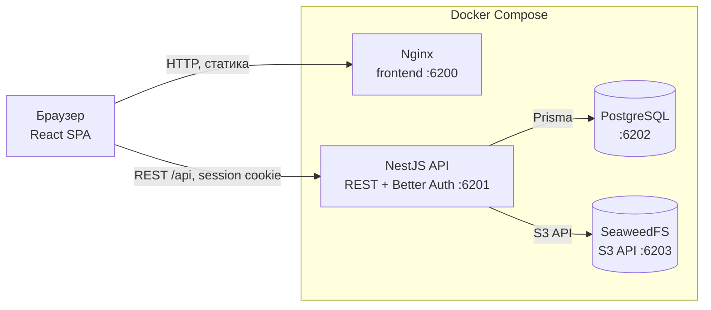

# HECHO

**HECHO** — учебная клиент-серверная доска заказов для одной организации: заказчик создаёт заказ, исполнитель выполняет работу, администратор управляет пользователями, распределением заказов, счетами и оплатой.

[Документация](./docs/README.md) · [Русская документация](./docs/ru/README.md) · [English documentation](./docs/en/README.md) · [English README](./README.en.md) · [Схема базы данных](./docs/ru/database-schema.md)

> [!IMPORTANT]
> **О проекте и качестве кода**
>
> Проект полностью создан в режиме вайб-кодинга (AI-assisted development) и может содержать неточности, неоптимальные решения и неполные сценарии. Автор — не профессиональный разработчик, а QA-инженер. Основная задача проекта — быть лёгкой и понятной базой для демонстрации автора как QA-инженера: навыков тест-дизайна, работы с требованиями, API и UI, QA-документации и автоматизации. Не рассматривайте этот код как production-ready эталон.

## Что это

Приложение для приёма заказов от зарегистрированных заказчиков, распределения и выполнения работ, учёта времени и выставления внутренних счетов. Поддерживаются три роли:

- **Заказчик** — создаёт заказы, согласует оценку, принимает работу, отправляет подтверждение оплаты.
- **Исполнитель** — берёт заказы из общего пула, предлагает часы и стоимость, выполняет работу, ведёт учёт времени.
- **Администратор** — управляет пользователями, распределяет и переназначает заказы, выставляет счета, проверяет оплату и завершает заказы.

Интерфейс локализован на английский (по умолчанию), русский и испанский языки.

## Технологии

| Слой | Что используется |
|---|---|
| Frontend | React 19, Vite 7, TypeScript, React Router, собственная i18n (`en` / `ru` / `es`) |
| Backend | NestJS 12, REST API, Swagger/OpenAPI, class-validator, PDFKit |
| Авторизация | Better Auth, серверные сессии в PostgreSQL, роли `CUSTOMER`, `EXECUTOR`, `ADMIN` |
| База данных | PostgreSQL 17, Prisma 7, миграции и SQL-ограничения |
| Файлы | SeaweedFS 4.52 через S3-совместимый API, лимит 1 MB на файл |
| Инфраструктура | Docker Compose, Nginx для раздачи frontend |
| Тесты | Unit-тесты API через `tsx --test`; e2e-автотесты ведутся в отдельном репозитории |

## Архитектура

Проект построен по клиент-серверной схеме. Браузер загружает статическое React-приложение с Nginx и обращается к NestJS API по REST; API проверяет сессию и права, работает с PostgreSQL через Prisma и хранит файлы в SeaweedFS.



- Frontend — одностраничное приложение с панелями `/customer`, `/executor` и `/admin`; прямые переходы по URL поддерживаются Nginx.
- API — доменная логика, авторизация, проверка ролей и переходов статусов, работа с файлами и генерация PDF-счетов.
- PostgreSQL — пользователи, категории, заказы, история, оценки, счета и платежи.
- SeaweedFS — вложения заказов и подтверждения оплаты.
- Docker Compose поднимает все сервисы, ждёт готовности PostgreSQL и применяет миграции перед стартом API.

## Быстрый старт

### Требования

- Docker Engine с Docker Compose v2 (`docker compose`); Docker Desktop подходит для Windows и macOS.
- Git.
- Свободные локальные порты `6200`–`6204`.
- Node.js `22.18+` и pnpm `12.15` нужны только для разработки на хосте; для запуска через Compose они не требуются.

### Запуск через Docker Compose

1. Клонируйте репозиторий и перейдите в его корень.
2. Создайте локальный файл окружения: `cp .env.example .env` (в Windows PowerShell: `Copy-Item .env.example .env`).
3. Замените в `.env` все значения `replace-this-*` на уникальные локальные пароли и секреты. Задайте `ADMIN_EMAIL` и `ADMIN_PASSWORD` для первого администратора. Пароль PostgreSQL должен быть URL-safe (буквы, цифры и `._~-`), потому что он используется в `DATABASE_URL`.
4. Соберите образы и запустите сервисы: `docker compose up --build -d`. Первый запуск может занять несколько минут; API дождётся PostgreSQL и применит миграции.
5. Создайте начального администратора: `docker compose exec api pnpm --filter @order-desk/api db:seed:admin`. Команда безопасна для повторного запуска.
6. Откройте `http://localhost:6200` и войдите под `ADMIN_EMAIL` / `ADMIN_PASSWORD`. Исполнителей создаёт администратор, заказчики регистрируются самостоятельно.

Контейнеры объявлены с `restart: "no"`, поэтому после перезагрузки ПК они не запускаются автоматически: поднимите стек вручную командой `docker compose up -d`.

| Сервис | Адрес по умолчанию |
|---|---|
| Frontend | `http://localhost:6200` |
| API | `http://localhost:6201/api` |
| Swagger | `http://localhost:6201/api/docs` |
| Health check | `http://localhost:6201/api/health` |
| PostgreSQL | `localhost:6202` |
| SeaweedFS S3 API | `http://localhost:6203` |
| SeaweedFS Admin UI | `http://localhost:6204` |

Все порты привязаны к `127.0.0.1` и доступны только с локальной машины. Подробности о настройке портов, разработке с hot reload и devtools API — в [инструкции по запуску](./docs/ru/README.md#запуск-проекта-локально).

## Документация

| Раздел | Русский | English |
|---|---|---|
| Полная документация | [docs/ru/README.md](./docs/ru/README.md) | [docs/en/README.md](./docs/en/README.md) |
| Назначение и функционал | [Функционал](./docs/ru/README.md#согласованный-функционал) | [Functionality](./docs/en/README.md#agreed-functionality) |
| Технические ограничения | [Ограничения](./docs/ru/README.md#технические-ограничения-и-пожелания) | [Constraints](./docs/en/README.md#technical-constraints-and-preferences) |
| План и статус реализации | [План](./docs/ru/README.md#план-реализации) | [Plan](./docs/en/README.md#implementation-plan) |
| Запуск и эксплуатация | [Запуск](./docs/ru/README.md#запуск-проекта-локально) | [Setup](./docs/en/README.md#running-the-project-locally) |
| Схема базы данных | [Схема БД](./docs/ru/database-schema.md) | [Database schema](./docs/en/database-schema.md) |

## Структура репозитория

```text
apps/web/            React SPA: лендинг, авторизация, панели ролей
apps/api/            NestJS API, Prisma-схема и миграции, тесты
docs/                двуязычная документация проекта
docker-compose.yml   PostgreSQL, SeaweedFS, API и frontend
```

## QA и тестирование

- Интерактивные элементы размечены стабильными `data-testid`, не зависящими от CSS и структуры DOM.
- Контракт API доступен в Swagger: `http://localhost:6201/api/docs`.
- Для подготовки данных есть devtools API; по умолчанию он выключен и защищён отдельным ключом. Полный сброс проекта (данные, пользователи, сессии и файлы) выполняется ручкой `POST /api/devtools/reset` или командой `pnpm db:reset`; администратор из `.env` создаётся заново.
- Unit-тесты API: `pnpm --filter @order-desk/api test`.
- Проверки типов и сборка: `pnpm typecheck`, `pnpm build`.
- Сквозные e2e-сценарии поддерживаются в отдельном учебном репозитории и не входят в этот проект.

## Связанные репозитории и артефакты

Ссылки на связанные материалы будут добавлены сюда позже:

- репозиторий с e2e-автотестами;
- тест-кейсы и чек-листы;
- коллекция API/Postman;
- баг-репорты и результаты тестирования.
