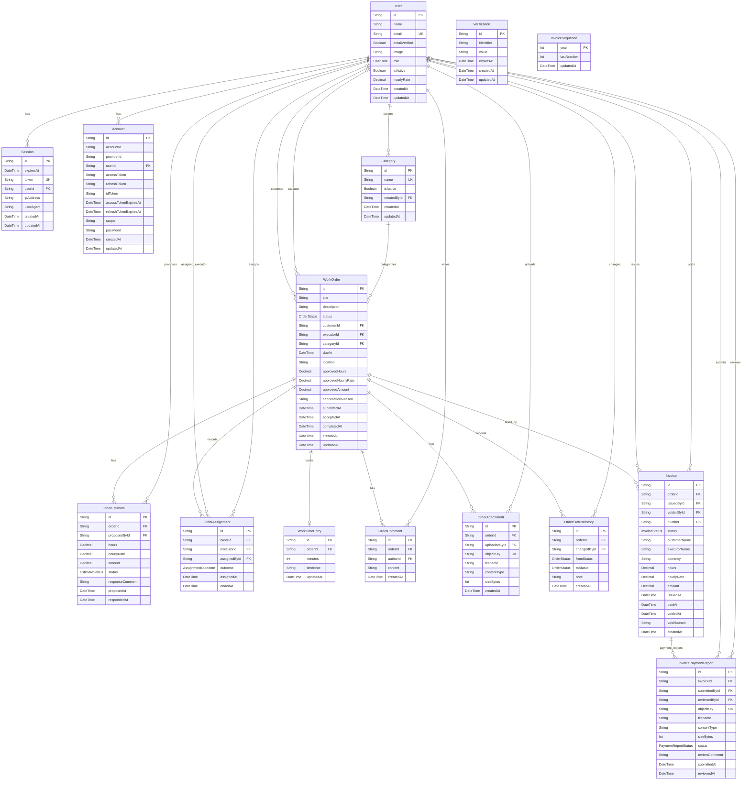

# Схема базы данных

Документ описывает текущую Prisma-модель PostgreSQL. Источник истины для типов, связей и полей — [`apps/api/prisma/schema.prisma`](../apps/api/prisma/schema.prisma); при изменении модели обновляйте эту диаграмму и описание ограничений.

## ER-диаграмма

`Verification` и `InvoiceSequence` не имеют внешних ключей: Better Auth ищет подтверждения по `identifier`, а годовой счётчик используется при выдаче номера счёта.
В диаграмме nullable-поля показаны без отдельного пометочного комментария ради совместимости Mermaid; их обязательность следует сверять с Prisma-моделью. Атрибут `WorkTimeEntry.timeNote` соответствует полю `WorkTimeEntry.comment` в Prisma.

## Доменные правила и ограничения

- Один пользователь имеет одну роль. `isActive = false` означает деактивированную учётную запись; исторические записи не удаляются. Перед деактивацией исполнителя все его незавершённые заказы должны быть переназначены.
- У заказа один текущий исполнитель (поле `WorkOrder.executorId`); `OrderAssignment` сохраняет историю назначений. Пул должен захватываться атомарно на уровне API.
- У заказа может быть несколько оценок за историю согласования и не более одной суммарной записи фактически затраченного времени.
- `WorkTimeEntry.orderId` уникален, поэтому на заказ приходится максимум одна запись времени.
- Для одного заказа допускается только одна ожидающая решения оценка. Ограничение обеспечивается частичным уникальным PostgreSQL-индексом `OrderEstimate_one_pending_per_order_key`, созданным миграцией.
- Ожидающая оценка получает `WITHDRAWN`, если исполнитель отказывается от назначения или администратор переназначает заказ до ответа заказчика.
- Принятие заказчиком фиксируется временем `WorkOrder.acceptedAt`; до выставления счёта статус остаётся `ON_REVIEW`, а факт приёмки отражается в истории статусов отдельным событием.
- `Invoice` хранит снимки имени заказчика, имени исполнителя, часов, ставки и суммы. Номера формируются в формате `INV-ГГГГ-000001` через `InvoiceSequence` внутри транзакции.
- Заказчик отправляет чек отдельной записью `InvoicePaymentReport`; документ доступен только заказчику и администраторам, не исполнителям. Чеки и решения администратора сохраняются как история.
- На счёте допускается не более одного ожидающего проверки чека; ограничение обеспечивается частичным уникальным индексом `InvoicePaymentReport_one_pending_per_invoice_key`.
- Само сообщение об оплате не меняет статус счёта или заказа. Подтверждение администратором переводит счёт в `PAID`, заказ в `INVOICE_PAID`, а запись чека в `CONFIRMED`. Завершение заказа — отдельное действие администратора, которое переводит заказ из `INVOICE_PAID` в `COMPLETED` и фиксирует `completedAt`; оно требует наличия оплаченного счёта. При отклонении требуется причина, запись получает `REJECTED`, заказчик может отправить новый чек.
- Аннулированный счёт остаётся в БД, его номер не используется повторно. Только неоплаченный счёт можно аннулировать; после аннулирования разрешается выпустить новый.
- Частичный уникальный индекс PostgreSQL `Invoice_one_current_per_order_key` гарантирует не более одного счёта со статусом, отличным от `VOID`, на заказ. Ограничение `Invoice_status_consistency_check` проверяет согласованность статусов `ISSUED`, `PAID`, `VOID` с полями оплаты и аннулирования. Эти два ограничения определены SQL-миграцией и не выражаются напрямую в Prisma Schema Language.
- Размер файлов и проверка прав доступа являются правилами API; в таблице `OrderAttachment` хранятся метаданные и ключ объекта в S3-совместимом хранилище.

## Перечисления

- `UserRole`: `CUSTOMER`, `EXECUTOR`, `ADMIN`
- `OrderStatus`: `NEW`, `WAITING_DISTRIBUTION`, `ASSIGNED`, `IN_PROGRESS`, `ON_REVIEW`, `NEEDS_REVISION`, `INVOICE_ISSUED`, `INVOICE_PAID`, `COMPLETED`, `CANCELLED`
- `EstimateStatus`: `PENDING`, `ACCEPTED`, `REJECTED`, `WITHDRAWN`
- `AssignmentOutcome`: `ACTIVE`, `DECLINED`, `REASSIGNED`, `RELEASED`
- `InvoiceStatus`: `ISSUED`, `PAID`, `VOID`
- `PaymentReportStatus`: `PENDING`, `REJECTED`, `CONFIRMED`
