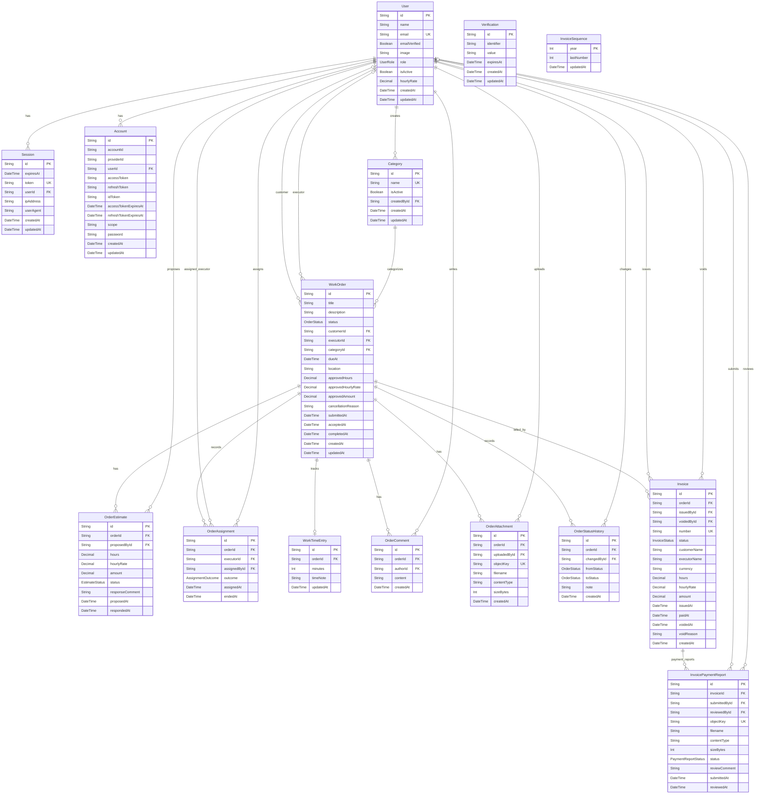

# Database schema

[← Documentation](./README.md) · [Русская версия](../ru/database-schema.md)

This document describes the current Prisma model for PostgreSQL. The source of truth for types, relations, and fields is [`apps/api/prisma/schema.prisma`](../../apps/api/prisma/schema.prisma); when changing the model, update this diagram and the constraint descriptions.

## ER diagram

`Verification` and `InvoiceSequence` have no foreign keys: Better Auth looks up verifications by `identifier`, and the yearly counter is used when issuing an invoice number.
For Mermaid compatibility, nullable fields are shown without a separate annotation; their optionality should be checked against the Prisma model. The `WorkTimeEntry.timeNote` attribute corresponds to the `WorkTimeEntry.comment` field in Prisma.

## Domain rules and constraints

- One user has one role. `isActive = false` means a deactivated account; historical records are not deleted. Before deactivating an executor, all their unfinished orders must be reassigned.
- An order has one current executor (`WorkOrder.executorId`); `OrderAssignment` preserves assignment history. The pool must be claimed atomically at the API level.
- An order can have multiple estimates over its approval history and at most one summary record of actual time spent.
- `WorkTimeEntry.orderId` is unique, so an order has at most one time entry.
- Only one estimate awaiting a decision is allowed per order. This constraint is enforced by the partial unique PostgreSQL index `OrderEstimate_one_pending_per_order_key`, created by a migration.
- A pending estimate becomes `WITHDRAWN` if the executor declines the assignment or the administrator reassigns the order before the customer responds.
- Customer acceptance is recorded by `WorkOrder.acceptedAt`; before an invoice is issued, the status remains `ON_REVIEW`, and acceptance is reflected in the status history as a separate event.
- `Invoice` stores snapshots of the customer name, executor name, hours, rate, and amount. Numbers are generated in the format `INV-YYYY-000001` through `InvoiceSequence` inside a transaction.
- The customer submits a receipt as a separate `InvoicePaymentReport` record; the document is available only to the customer and administrators, not to executors. Receipts and administrator decisions are preserved as history.
- At most one receipt awaiting review is allowed per invoice; the constraint is enforced by the partial unique index `InvoicePaymentReport_one_pending_per_invoice_key`.
- The payment report itself does not change the invoice or order status. Administrator confirmation moves the invoice to `PAID`, the order to `INVOICE_PAID`, and the receipt record to `CONFIRMED`. Completing the order is a separate administrator action that moves the order from `INVOICE_PAID` to `COMPLETED` and records `completedAt`; it requires a paid invoice. Rejection requires a reason, the record becomes `REJECTED`, and the customer can submit a new receipt.
- A voided invoice remains in the database, and its number is not reused. Only an unpaid invoice can be voided; after voiding, a new invoice may be issued.
- The partial unique PostgreSQL index `Invoice_one_current_per_order_key` guarantees at most one invoice per order with a status other than `VOID`. The `Invoice_status_consistency_check` constraint verifies that the `ISSUED`, `PAID`, and `VOID` statuses are consistent with the payment and voiding fields. These two constraints are defined in a SQL migration and cannot be expressed directly in Prisma Schema Language.
- File size and access checks are API rules; the `OrderAttachment` table stores metadata and the object key in S3-compatible storage.

## Enums

- `UserRole`: `CUSTOMER`, `EXECUTOR`, `ADMIN`
- `OrderStatus`: `NEW`, `WAITING_DISTRIBUTION`, `ASSIGNED`, `IN_PROGRESS`, `ON_REVIEW`, `NEEDS_REVISION`, `INVOICE_ISSUED`, `INVOICE_PAID`, `COMPLETED`, `CANCELLED`
- `EstimateStatus`: `PENDING`, `ACCEPTED`, `REJECTED`, `WITHDRAWN`
- `AssignmentOutcome`: `ACTIVE`, `DECLINED`, `REASSIGNED`, `RELEASED`
- `InvoiceStatus`: `ISSUED`, `PAID`, `VOID`
- `PaymentReportStatus`: `PENDING`, `REJECTED`, `CONFIRMED`
